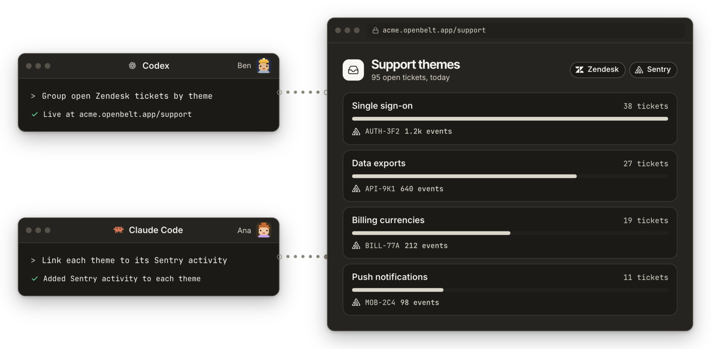

<p align="center">
  <picture>
    <source media="(prefers-color-scheme: dark)" srcset="brand/logo/openbelt-white.svg">
    
  </picture>
</p>

**The open-source tool belt for you and your agents.** Build tools with any agent and share them
with your team. OpenBelt hosts them with data and realtime built in.



## Start

Paste this into Claude Code, Codex, Cursor or any MCP client:

```
Read https://openbelt.com/start.md, then help me build a tool
```

It connects your agent to [openbelt.com](https://openbelt.com) (free for personal use) and builds
your first tool. To run your own, see [Self-host](#self-host).

## What every tool gets

- **Data.** Its own database. Read other tools' data too.
- **Realtime.** Watch a query and the page updates when the data changes.
- **Functions.** Server code that pages, other tools and agents can call.
- **Jobs.** Run on a schedule, or later in the background.
- **Webhooks.** Events from GitHub, Stripe or Shopify, with signatures checked.
- **Users and secrets.** Know who uses each tool. Call APIs without exposing a key.
- **Connections.** Connect Gmail, GitHub, Linear or any MCP server once. Every agent and tool can
  use it.

## Self-host

Runs on any Docker host. Create a private `.env` once (the command refuses to overwrite one), then
start it:

```sh
git clone https://github.com/janedogco/openbelt && cd openbelt
(
  umask 077
  set -C
  printf 'OPENBELT_ADMIN_TOKEN=%s\nOPENBELT_SECRETS_KEY=%s\nOPENBELT_SIGNIN=off\n' \
    "$(openssl rand -hex 24)" "$(openssl rand -hex 32)" > .env
)
docker compose up -d
```

Open `http://acme.localhost:1337`. Sign-in is off, so keep the port on `127.0.0.1`, as Compose
binds it. To share it, follow [Running on a server](docs/running.md#running-on-a-server) and
[Sign-in](docs/viewers.md). Keep `.env` and backups private, and keep the secrets key across
restarts.

## Work on OpenBelt

```sh
bun install --frozen-lockfile
bun run dev
```

Install Bun 1.4.0, Rust 1.91.1 and Gitleaks 8.30.1 first. Read [Architecture](docs/architecture.md)
and [Vision](VISION.md). Run `bun run check` before you push. Raw evidence under `.verify/` holds
credentials and app data: keep it local.

## License

[MIT](LICENSE), all of it. [NOTICE](NOTICE) lists third-party components, and
[TRADEMARKS.md](TRADEMARKS.md) covers the name and logo. To report a vulnerability, see
[SECURITY.md](SECURITY.md).
